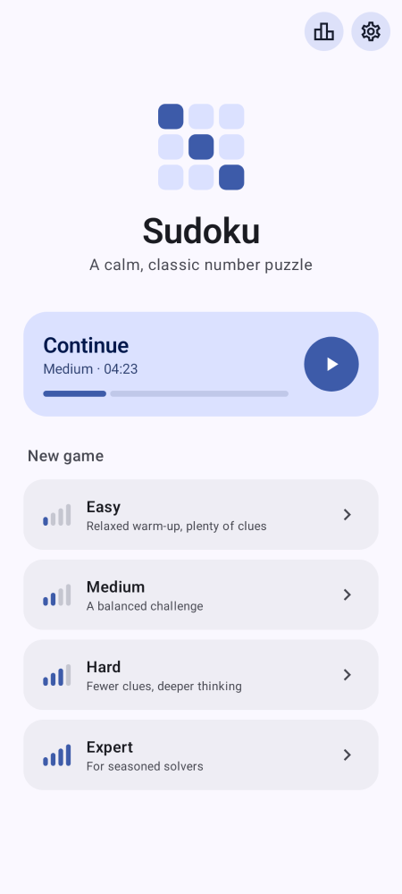
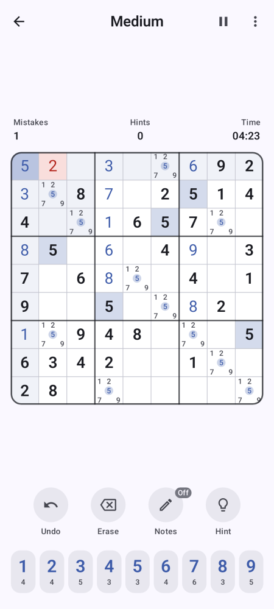
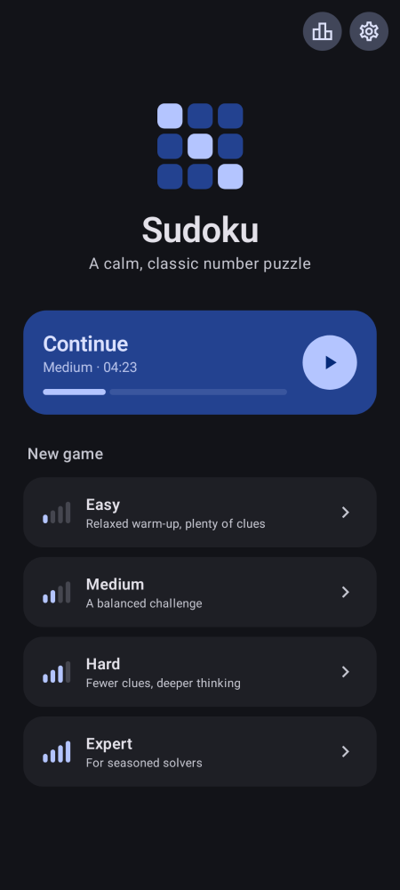
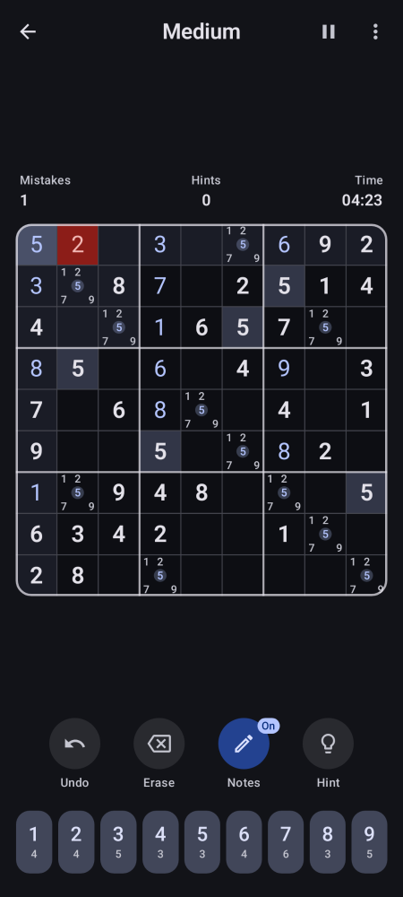

# Sudoku

A modern, clean Sudoku app for Android, built with Kotlin, Jetpack Compose and Material 3.

<p>
  
  
  
  
</p>

## Features

- **Endless puzzles** in four difficulties (Easy, Medium, Hard, Expert). Every puzzle is generated on the device and has exactly one solution.
- **Notes** (pencil marks), with optional auto-removal when you place a number.
- **Undo, erase and hints.**
- **Smart highlighting** of the selected row, column and box, and of identical numbers (including matching notes).
- **Mistake checking**, with an optional 3-mistake limit. With checking off, only duplicate numbers in a row, column or box are flagged.
- **Quit a game** from the menu, optionally revealing the solution (counts as a loss).
- **Learn section** with six step-by-step lessons (rules, hidden and naked singles, candidates and naked pairs, pointing, hidden pairs). Each has explanations, a worked example and practice puzzles with instant feedback.
- **Training drills** for every technique: timed rounds on fresh positions, with best scores saved.
- **Timer** that pauses when you leave the app, plus a pause button that hides the board.
- **Auto-save**: close the app at any time and continue later.
- **Statistics** per difficulty: games played and won, win rate, best and average time, win streaks.
- **Light and dark themes**, and Material You dynamic color on Android 12+.
- Number pad shows how many of each digit are left; works in portrait and landscape.

## Building

Requirements: JDK 17+ and the Android SDK (platform 35).

```sh
./gradlew assembleDebug        # app/build/outputs/apk/debug/app-debug.apk
./gradlew assembleRelease      # minified build, signed with the debug key
./gradlew testDebugUnitTest    # solver, generator, game-state and technique tests
```

Install on a connected device with `./gradlew installDebug`. Every push to `main` also builds the APKs on GitHub Actions (see the run's artifacts).

## Releases

Running the **Release** workflow from the Actions tab with a version number, or pushing a version tag (`git tag v1.0.0 && git push origin v1.0.0`), builds a signed APK and App Bundle and publishes them as a GitHub release. See [docs/RELEASING.md](docs/RELEASING.md) for the one-time signing setup.

Local release builds without the signing secrets fall back to the debug key, so they still install for testing.

## Project layout

```
app/src/main/java/de/wtzg/sudoku/
├── domain/   Solver, puzzle generator, game state (pure Kotlin, unit-tested)
│   └── learn/  Technique finder and exercise generator for the learning section
├── data/     Settings, statistics and saved game (SharedPreferences)
└── ui/       ViewModels, theme, board/number pad components and screens
    └── learn/  Lessons, training drills and their content
```

Requires Android 8.0 (API 26) or newer.
